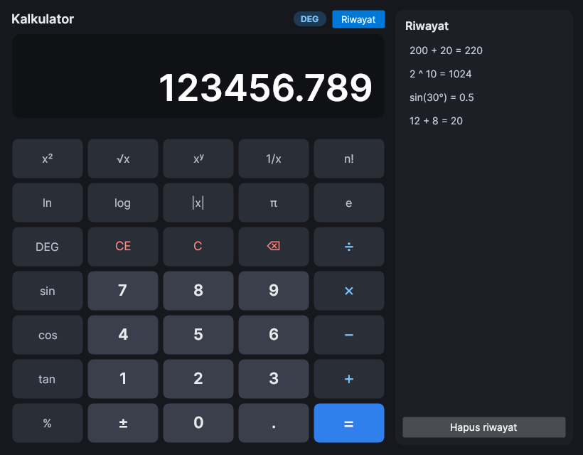
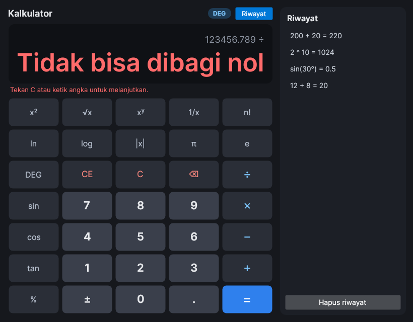
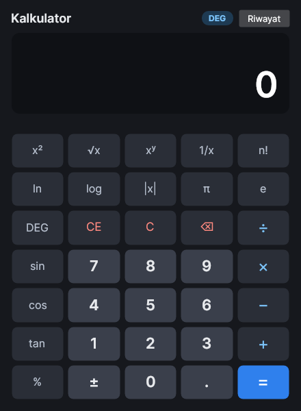

# Kalkulator Saintifik Desktop (C# · Avalonia UI)

Aplikasi kalkulator desktop lintas platform (Windows, Linux, macOS) yang dibangun dengan C# .NET 8 dan Avalonia UI 11. Aplikasi ini mendukung operasi aritmetika dasar, fungsi saintifik, input dari keyboard, dan riwayat perhitungan.



## Menjalankan

Prasyarat: .NET SDK 8 atau yang lebih baru (`dotnet --list-sdks`).

```bash
cd KalkulatorSaintifik
dotnet run --project src/KalkulatorSaintifik     # menjalankan aplikasi
dotnet test                                      # menjalankan 56 unit test
```

Pembuatan proyek dari nol mengikuti langkah modul:

```bash
dotnet new install Avalonia.Templates
dotnet new avalonia.app -n KalkulatorSaintifik
```

## Struktur proyek

```
KalkulatorSaintifik/
├── KalkulatorSaintifik.sln
├── src/KalkulatorSaintifik/
│   ├── KalkulatorSaintifik.csproj
│   ├── Program.cs               titik awal aplikasi (Main, BuildAvaloniaApp)
│   ├── App.axaml(.cs)           tema Fluent (dark) dan pembuatan MainWindow
│   ├── MainWindow.axaml         tampilan: layar, keypad 5×7, panel riwayat
│   ├── MainWindow.axaml.cs      event handler tombol dan keyboard
│   └── Core/MesinKalkulator.cs  seluruh logika perhitungan (tanpa UI)
├── tests/KalkulatorSaintifik.Tests/
│   └── MesinKalkulatorTests.cs  unit test xUnit
└── docs/                        tangkapan layar
```

Perbedaan utama dengan contoh di modul terletak pada pemisahan logika. Perhitungan tidak ditulis di `MainWindow.axaml.cs`, melainkan di class `MesinKalkulator` yang tidak bergantung pada Avalonia. Code-behind hanya meneruskan input ke mesin lalu memanggil `PerbaruiTampilan()`. Dengan pemisahan ini, semua skenario pengujian dapat dijalankan otomatis melalui `dotnet test` tanpa membuka jendela.

## Fitur

| Kategori | Fitur |
|---|---|
| Aritmetika | `+`, `−`, `×`, `÷`, pangkat `xʸ`, operasi berantai (`10 + 5 + 3 =` → 18) |
| Persen | `50 %` → 0.5; `200 + 10 %` → 220 (persen dari angka pertama) |
| Saintifik | sin, cos, tan (mode DEG/RAD), `x²`, `√x`, `ln`, `log`, `1/x`, `n!`, `|x|`, konstanta π dan e |
| Input | digit maksimal 15, titik desimal hanya sekali, nol di depan dihapus, `±`, `⌫`, `CE`, `C` |
| Riwayat | panel riwayat (terbaru di atas); klik item untuk memakai hasilnya lagi; panel otomatis disembunyikan saat jendela sempit |
| Error | bagi nol, angka kedua kosong, akar negatif, ln/log ≤ 0, tan 90°, faktorial non-bulat atau > 170, overflow |

### Keyboard

| Tombol | Aksi | Tombol | Aksi |
|---|---|---|---|
| `0`–`9`, `.` atau `,` | angka dan desimal | `Enter` atau `=` | hitung |
| `+ - * /` (juga `x`, `:`) | operator | `Backspace` | hapus satu karakter |
| `^` | pangkat | `Delete` | CE |
| `%` | persen | `Esc` | C |
| `!` | faktorial | `p` | π |

## Komponen antarmuka

| Kontrol | Name | Keterangan |
|---|---|---|
| TextBlock | `LblJudul` | judul "Kalkulator" |
| TextBlock | `TxtEkspresi` | ekspresi yang sedang/baru dihitung, mis. `12 + 8 =` |
| TextBlock | `TxtLayar` | angka atau hasil; dibungkus `Viewbox` agar angka panjang mengecil, bukan terpotong |
| TextBlock | `TxtError` | petunjuk merah saat terjadi error |
| Button | `Btn0`–`Btn9`, `BtnDecimal`, `BtnNegate` | input angka → `OnAngkaClick`, `OnTitikClick`, `OnGantiTandaClick` |
| Button | `BtnPlus`, `BtnMinus`, `BtnMultiply`, `BtnDivide` | operator → `OnOperatorClick` (jenis operator dari `Tag`) |
| Button | sin, cos, tan, x², √x, … | fungsi → `OnFungsiClick` (jenis fungsi dari `Tag`) |
| Button | `BtnClear`, `BtnClearEntry`, `BtnBackspace`, `BtnEquals`, `BtnMode` | C, CE, ⌫, =, DEG/RAD |
| ListBox | `ListRiwayat` | daftar riwayat perhitungan |

Semua tombol keypad memakai satu style (`Grid.keypad > Button`) sehingga ukuran dan margin seragam. Kelas `angka`, `operator`, `sains`, `hapus`, dan `samadengan` hanya membedakan warnanya. Tombol diberi `Focusable="False"` agar menekan `Enter` di keyboard tidak "mengklik" ulang tombol yang terakhir ditekan.

## Logika (`MesinKalkulator`)

| Anggota | Fungsi |
|---|---|
| `_input` | angka yang sedang diketik (string) |
| `_operandKiri` | angka pertama |
| `_operasi` | operator yang menunggu angka kedua (`OperasiBiner?`) |
| `_baruSelesai` | `true` setelah `=` atau fungsi; angka berikutnya memulai input baru |
| `MasukkanDigit`, `MasukkanTitik` | validasi batas 15 digit, satu titik desimal, dan nol di depan |
| `PilihOperator` | menyimpan angka pertama; bila sudah ada operasi tertunda, hasil antara dihitung dulu (berantai) |
| `Hitung` | tombol `=`; memvalidasi angka kedua dan pembagian nol, lalu mencatat ke riwayat |
| `TerapkanFungsi` | fungsi satu operand; derajat dikonversi ke radian bila mode DEG aktif |
| `Format` | maksimal 15 digit signifikan (`G15`) dan notasi ilmiah untuk nilai ≥ 10¹⁵ atau < 10⁻⁷ |

Nilai seperti sin 180° secara floating point menghasilkan 1.2 × 10⁻¹⁶. Hasil di bawah 10⁻¹² dibulatkan menjadi 0 agar layar menampilkan `0`.

## Pengujian

Skenario dari modul ditambah kasus tambahan, semuanya otomatis di `MesinKalkulatorTests.cs` (56 tes, semua lulus).

| No | Skenario | Input | Diharapkan | Aktual |
|---|---|---|---|---|
| 1 | Penjumlahan | 10 + 20 | 30 | 30 |
| 2 | Pengurangan | 30 − 12 | 18 | 18 |
| 3 | Perkalian | 6 × 7 | 42 | 42 |
| 4 | Pembagian | 100 ÷ 4 | 25 | 25 |
| 5 | Desimal | 2.5 × 4 | 10 | 10 |
| 6 | Bagi nol | 10 ÷ 0 | pesan error | "Tidak bisa dibagi nol" |
| 7 | Clear | tekan C | layar = 0 | 0 |
| 8 | Angka kedua kosong | 5 + lalu = | pesan error | "Angka kedua kosong" |
| 9 | Presisi floating point | 0.1 + 0.2 | 0.3 | 0.3 |
| 10 | Operasi berantai | 10 + 5 + 3 = | 18 | 18 |
| 11 | Persen | 200 + 10 % = | 220 | 220 |
| 12 | Sinus (DEG) | 30 sin | 0.5 | 0.5 |
| 13 | Tangen tak terdefinisi | 90 tan | error | "Domain error" |
| 14 | Faktorial | 5 n! | 120 | 120 |
| 15 | Akar negatif | −4 √ | error | "Input tidak valid" |
| 16 | Batas digit | ketik 19 digit | 15 digit pertama | 123456789012345 |

<p>
  
  
</p>

## Referensi

- Modul Hands-on Lab: Kalkulator Desktop dengan C#
- Dokumentasi Avalonia UI: https://docs.avaloniaui.net
